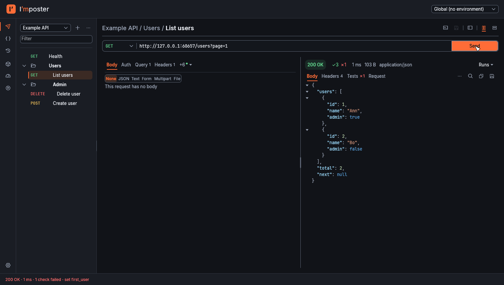
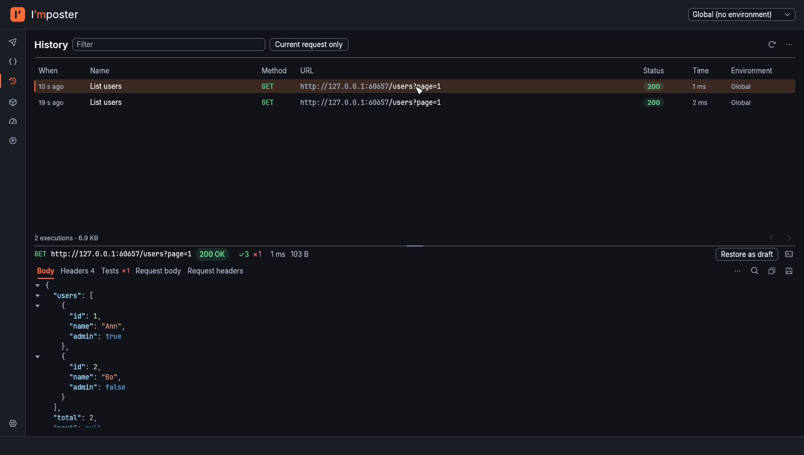

# I’mposter

A fast, local desktop HTTP API client. Build requests, organize them in collections, reuse
values through variables and environments, and keep a searchable history of everything you
sent. It runs as one native binary per OS, with no account, no cloud and no telemetry.



I’mposter is written in Rust with [egui](https://github.com/emilk/egui). Collections export
as `.imposter.json` (native version 4 when a capture stores a secret, 3 when scripts are
present, otherwise version 2).

On one M3 Pro Mac, the packaged 0.6.0 smoke workflow measured **218.6 ms median
launch-to-request** and **106.1 MiB median peak resident memory** across ten runs after
a warm-up. These are warm-cache, fresh-profile measurements, not first-frame or idle-memory
figures. See the [machine, method and all samples](docs/validation.md#packaged-060-measurements).

## Features

**Requests**
- Collections with nested folders. Drag requests and folders to reorder them or move them into a folder, or use Move up, Move down (Alt+↑/↓) and Move….
- Any method, custom methods included; query parameters kept in sync with the URL.
- Headers, cookies, and bodies as JSON, plain text, URL-encoded form, multipart (text fields
  and file uploads) or a binary file. Uploads are streamed from disk.
- **Outline** shows a read-only, searchable view of a JSON request body with collapsible
  objects and arrays.
- Type into the empty trailing row to add a query parameter, header, cookie or form field.
- Authentication: Basic, Bearer, Digest (MD5, SHA-256, SHA-512, `-sess`), an API key in
  a header or the query, and OAuth 2.0: client credentials (the token is fetched when you
  send) or authorization code with PKCE (you **Sign in** in your browser, and the app
  listens on 127.0.0.1 for the redirect). Tokens are kept per environment, reused until
  30 seconds before they expire and refreshed when the server gave a refresh token. A
  token request that fails says why ("Token request failed: invalid_client") and nothing
  is sent; when signing in is needed, the send says so and offers **Sign in**. The Auth
  tab says how long the token is valid for, with **Get new token** (or **Sign in**) and
  **Clear token**. Runs keep their tokens to themselves; the command line fetches its own
  client credentials token and never signs in.
- A cookie jar per environment: cookies a server sets (a login's session cookie) are sent
  back on later requests where their domain, path and `Secure` flag allow, redirects
  included. Your own cookie rows win over the jar's. Turn it off in **Settings → Network**
  with **Keep cookies**, or per request. Runs keep their cookies to themselves, and the command line
  starts each run with an empty jar.
- Server-sent events: a `text/event-stream` response shows its events as they arrive on an
  **Events** tab (time, event, data; choose one to read it whole), and Send becomes
  **Stop**. A request can stop listening after some seconds or events under
  **More → Settings → Event streams**. This ends the stream normally so checks can evaluate
  what arrived.
  A stream cut at the response limit, timed out or stopped never passes.
- Per-request settings that override the application defaults: timeout, redirects,
  certificate verification, cookies, the cookie jar, proxy, CA bundle, client certificate
  and key, and response size limit. In **More → Settings**, choose **Default**, **On** or
  **Off** for on/off overrides. Hover over **Default** to see the application setting.
  Text fields show the inherited value until you enter an override, which you can clear
  with the reset icon.
- **More → Docs** edits the request description that saves and exports with it.
- Right-click a request and choose **Duplicate** to create and open a saved sibling copy.
  An open request copies its current edits; navigation still resolves unsaved changes.
- **Settings → General → Automatically save changes** is on by default and covers
  requests, variables and mocks. Valid edits save after half a second. If you are typing
  in a text field, the delay starts when focus leaves the field or window. Navigation
  that replaces the editor saves sooner. If the changes are invalid or
  saving fails, the editor keeps your edits and asks what to do before continuing.
  You can also use **Save** or Cmd/Ctrl+S.

**Variables**
- `{{name}}` placeholders in the URL, headers, body, auth and settings.
- Open **Variables** from the rail and pick **Global**, an environment or a collection
  from the scope list on the left. Global and environment scopes have **Variables**,
  **Secrets** and **Cookies** tabs. Collections have **Variables**. Type into the empty
  trailing row to add a variable or secret. The active environment has a check and
  overrides collection values, which override globals.
- Use the Plus beside **Environments** to create one. Right-click or press Shift+F10 on
  an environment to edit its name and color or delete it.
- Give an environment a color (a new one named "prod", "production" or "live" is offered
  red). The header's environment picker shows the active environment and uses its color.
  Hover over **Send** for the full name of the active environment.
- Placeholders are highlighted: defined names in orange, unknown ones in red. Typing `{{`
  suggests names. Clicking a placeholder, or pressing Alt+Enter, shows where its value comes
  from. Values from password fields stay masked until revealed.
- Generated values, made fresh for each send: `{{$uuid}}`, `{{$timestamp}}`,
  `{{$timestampMs}}`, `{{$isoTimestamp}}`, `{{$date %Y-%m-%d}}` (each takes an offset such as
  `-1d` or `+2h`), `{{$randomInt 1 100}}` and `{{$randomString 12}}`. One expression is one
  value throughout a send, so the same `{{$uuid}}` in the URL and the body match; add a word
  for another value (`{{$uuid second}}`). Postman's `$guid`, `$randomUUID`, `$timestamp`,
  `$isoTimestamp` and `$randomInt` work as imported. Type `{{$` for the list.
- Secrets: write `{{secret:token}}` for a token, password or key. Its value lives on the
  **Secrets** tab in Variables, for Global or an environment (the active
  environment's first), masked, and only on this computer: never exported, and removed from
  History, which shows `«redacted»` instead. The inspector always masks it until Reveal. A
  capture's lock stores a login's token as a secret instead of a variable, and scripts
  have `secrets.get` and `secrets.set`. Secrets are kept unencrypted in your profile
  database (and its upgrade backups), like the rest of your data.
- The **Cookies** tab in Variables lists what servers set for the selected environment's
  requests or, for Global, requests sent without an environment. Each row shows a masked
  value and where and until when the cookie is sent. Removing one or using **Clear cookies…**
  asks for confirmation.
  Cookies are kept only on this computer.
- In Variables, each row shows its values as chips. Type in **Add value**, then press
  Enter to add and select it or Save to add it while saving the scope. Click a chip to
  select it. Right-click or press Shift+F10 on a focused chip to copy or remove it.
  The filled chip marks the selection. Each capture or script update replaces one
  **Latest capture** chip on this device and selects it for the next request. Use
  **Keep in list** to keep that value alongside the ordinary choices. Native exports carry
  saved values with their variables. Postman exports carry the current value only.

**Responses**
- Status, time, size and content type at a glance.
- JSON, XML and HTML highlighting, formatted JSON, find, wrap and copy. Large bodies stay
  responsive (the viewer only lays out what is visible; previews stop at 256 KiB by
  default, and Settings → Appearance → Response preview raises that to 1 or 4 MiB).
- **More tools** (⋯) holds Wrap, Collapse all, Expand all and Filter with JSONPath.
  Find and Copy sit beside it, with Save body… when space allows.
- Fold formatted JSON by object or array, or collapse everything below the top level.
  Hover a line and open its **⋯** menu, or right-click, to copy its JSONPath
  (`$.data.items[3].id`) or its value.
- Filter a JSON response with JSONPath (RFC 9535), for example `$.items[?@.active == true].id`.
  The filter reads the whole captured body, not just the preview, and stays set when you send
  again. Copying the path of a result gives its path in the full body.
- Earlier runs of the same request stay one click away.

**Checks**
- Add checks with the Plus in **More → Tests**. They run after every response and can check the
  status (`= 200`, `= 2xx`), a header, a JSONPath into the body, the body text, the duration
  or the size, compared with `=`, `≠`, `<`, `≤`, `>`, `≥`, contains, matches (a regular
  expression), exists or is of type. Expected values can use `{{variables}}`.
- Results appear beside the response status (for example, `✓3 ✗1`) and in its Tests tab,
  with a status icon and what was read for each check. They stay with the run in History.
  An unchecked result shows the reason beside a warning icon.
- Right-click a JSON value and choose Add check to check for it. OpenAPI import adds a status
  check for each operation's documented success.
- Use the Plus in **More → Captures** to set variables from a response, such as a login's
  `token` from `$.access_token` or a created item's ID. The value goes to the scope that
  defines the variable, or to the active
  environment, and the next request uses it. Right-click a JSON value and choose Set variable
  to add one. If the scope has unsaved edits, the response shows a **not set** badge.
  Hover for the affected names and click to open the scope in Variables.

**Scripts**
- Each request can have two [Rhai](https://rhai.rs) scripts, edited under **More → Scripts**. The
  before-sending script runs with variables and generated values filled in and can change
  the method, URL, query, headers and a JSON or text body; what it changes is what is sent,
  and what History and Copy as curl show. Use it to sign a request (HMAC), add computed
  headers or stamp a body.
- The after-response script reads the response (status, headers, body, JSON, JSONPath) and
  runs tests, shown with the checks and kept in History. Both scripts can set variables,
  which go where captures go.
- Scripts never touch files, the network or the environment. Each may run 2 seconds and a
  million operations; Cancel stops one. A failing before-sending script stops the send and
  says which line failed. What scripts print shows under the response and is not kept.
- A collection or folder can have the same two scripts, run around every request inside it:
  shared signing, an API key header, common tests. Open them from the collection's "⋯" menu
  (**Collection Scripts…**) or a folder's right-click menu (**Scripts…**). Before sending,
  the collection's run first, then each folder's from the outermost, then the request's;
  after the response, in the same order. A request's Scripts tab lists what else runs.
- Each script header shows the compile result and has a Plus button for **Insert example…**.
  **Script reference** at the right of the request tab row lists everything below.

| When | Use | What it does |
|---|---|---|
| Before sending | `request.method, request.url` | Read or change the method and URL. Setting the URL takes its query from it. |
| Before sending | `request.header(name), request.set_header(name, value), request.add_header(name, value), request.remove_header(name)` | Read or change headers; names ignore case. set_header replaces every value of the name. Auth headers are added after the script. |
| Before sending | `request.query(name), request.set_query(name, value), request.remove_query(name)` | Read or change query parameters; the URL follows. |
| Before sending | `request.body, request.json()` | The body as text, or parsed as JSON. A JSON or text body can be replaced; form, multipart and file bodies cannot. |
| After response | `request` | The request as it was sent: the same fields, read-only. |
| After response | `response.status, response.reason, response.time_ms, response.size, response.truncated` | The status, its reason, the time in milliseconds, the body's size in bytes, and whether the body was cut at the capture limit. |
| After response | `response.header(name), response.headers` | One header (every value joined with ", "), or all of them by lowercase name. |
| After response | `response.body, response.json(), response.path(jsonpath)` | The body as text, parsed as JSON, or the value a JSONPath selects (several values as an array, none as ()). |
| After response | `test(name, condition), test(name, \|\| { … })` | A test, shown with the checks and kept in History. A closure fails when it returns false or throws. |
| Request scripts | `vars.get(name), vars.set(name, value)` | Read a variable, or set one for later requests: it goes where captures go (the scope that defines it, else the active environment, else Global). |
| Request scripts | `secrets.get(name), secrets.set(name, value)` | Read a secret ({{secret:name}}), or store one for later requests: it goes where a secret capture goes (the secrets that define it, else the active environment's, else the global ones), never into a variable or History. |
| Mock responses | `request.method, request.path, request.query(name), request.header(name), request.headers` | The request the route matched, read-only; headers by name, ignoring case. |
| Mock responses | `request.body, request.json()` | The request's body as text (up to 1 MiB), or parsed as JSON. |
| Mock responses | `response.status, response.body, response.set_header(name, value), response.remove_header(name)` | The answer, starting from the route's status, headers and body. Statuses are 200 to 599; the server sets Content-Length itself. |
| Mock responses | `response.send_json(value)` | Answer with a value as JSON, setting Content-Type. |
| Mock responses | `response.delay_ms` | Wait before answering, up to 10,000 ms. |
| Mock responses | `state` | A map kept between requests while the server runs; it starts empty on every Start. |
| Every script | `expect(actual, expected)` | Throws "expected …, got …" when they differ: inside a test it fails the test with that message. |
| Every script | `sha256(data), sha512(data), sha1(data), md5(data)` | Digests of text or bytes, as bytes. |
| Every script | `hmac_sha256(key, data), hmac_sha512(key, data), hmac_sha1(key, data)` | HMACs of text or bytes, as bytes; a key may be the bytes of an earlier HMAC. |
| Every script | `hex(data), base64_encode(data), base64url_encode(data), base64_decode(text)` | Encode text or bytes; base64_decode gives bytes (`.as_string()` reads them as text). |
| Every script | `url_encode(text), url_decode(text)` | Percent-encoding as RFC 3986: everything but letters, digits and - _ . ~ is escaped. |
| Every script | `uuid(), now_ms(), now_iso(), random_int(min, max)` | Generated values, as {{$uuid}}, {{$timestampMs}}, {{$isoTimestamp}} and {{$randomInt}} make them. |
| Every script | `parse_json(text), to_json(value)` | JSON text to a value and back. |
| Every script | `print(value), debug(value)` | Write to the console: under the response (not kept in History), or in the Mocks screen's request log. |

**Runs**
- Send every request of a collection or a folder in the sidebar's order from the Run screen
  (the left rail, "Run…" in a collection's ⋯ menu or a folder's right-click menu, or the
  command palette), as `imposter run` does. A value a request captures reaches the requests
  after it; your variables do not change.
- **What to run** searches every collection and folder.
- The environment defaults to the active one. Choose another beside **Keep going after a
  failure**. With a red environment, **Run** asks first. The run stops at the first request
  that does not pass and skips the rest unless **Keep going after a failure** is on.
- Each request shows its outcome as it ends; select one to see its response, checks and the
  request as sent. The summary uses the command line's rule: a run passes when no request
  failed and at least one check ran. Every request sent is in History; the last ten runs of
  the session stay a menu away.

**Load tests**
- Send one request many times from the Load screen (the left rail, a request's right-click menu,
  or the command palette), as `ab` does. The toolbar button shows the selected method and
  request. Set total requests, concurrency, optional time limit and ramp-up, and keep-alive
  in the configuration pane. Every request gets fresh generated values.
- The summary: requests and bytes per second, the share of errors (failed checks count),
  min, mean and percentiles of the whole exchange and of the time to the first byte, a
  "served within" table, counts by status and error, and a latency histogram. The last ten
  runs of the session stay a menu away.
- The request's scripts run for every request, so signed APIs can be load-tested; the
  after-response script's tests count with the checks. Script time is not counted as
  response time, and the first script error is shown on the result.
- Runs stay out of History and never set variables, from captures or scripts. With a red
  environment active, Start asks first.
- This is a **closed-loop, single-request probe**: each worker waits for its response before
  sending again. A slow server therefore receives fewer requests, which can understate tail
  latency compared with independent arrivals. These results do not establish production
  capacity; use a specialist load-testing tool for that work.

**History**
- Every execution with its environment, the request exactly as it was sent, and the
  captured response, subject to the configured capture and history limits.
- Hover over **Filter** for syntax such as `status:4xx`, `env:Dev` and `via:cli`.
  Plain words match the request name and URL.
- Use **Current request only** beside the filter to narrow the list. Select an execution to
  inspect its response and the request as sent from one tab row. The detail header has
  **Restore as draft** and the **Copy as curl** icon.
- The footer shows the retained execution count and size. Hover over it for the current page
  range and retention limits.



**Mocks**
- Open **Mocks** in the left rail to configure a local HTTP server on `127.0.0.1`. Use the
  **Port** field to choose a port (8080 by default, `auto` at 0). Use the Plus in the
  **Routes** header to add a route by exact method and encoded path. Edit the response in
  the **Body**, **Headers**, and **Script** tabs. **Body** opens by default and highlights
  JSON. **Headers** counts headers in use, and **Script** shows a dot when set. A red badge
  marks a tab with a problem. Mocks remembers your tab when you switch routes during a session.
  Query strings and request bodies do not affect matching, and unmatched requests
  return 404. **Start** is available once the configuration is saved and valid. The
  running URL and its copy icon are in the toolbar. After configuration edits save, use
  **Stop** and **Start** to apply them to a running server.
  Configuration persists across sessions. The server starts on demand and stops when
  Imposter closes.
- A mock answers locally from the routes and scripts you define. A passing check against
  that answer does **not verify the live API**.
- A route can also have a response script (Rhai, as request scripts are) that starts from
  its status, headers and body and changes them from the request: echo it, answer 400 when
  a field is missing, fail the first call and succeed after, or wait before answering.
  `state` keeps values between requests until the server stops:

```rhai
state.calls = (state.calls ?? 0) + 1;
if state.calls == 1 { response.status = 503; }
response.send_json(#{ calls: state.calls, item: request.json().item });
```

- Scripts read request bodies up to 1 MiB, run one at a time for at most a second, and a
  failing one answers 500 with its line. A route whose script does not compile keeps the
  server from starting. While it runs, "Answered requests" lists what came in and what went
  out, with script errors and printed lines (never bodies).

**Import and export**
- Native `.imposter.json` (`"format": "imposter"`) carries request checks, captures, saved
  variable values and environment colors. Exports use **version 4** when a capture stores
  a secret, **version 3** when a request, folder or collection has scripts, and
  **version 2** otherwise. Script-free exports remain readable by Imposter 0.4. Secret
  values are never exported; `{{secret:name}}` references are.
- Postman Collection v2.1 import and export, validated against the official schema, with
  environment and globals files. Anything Postman features Imposter cannot represent is listed
  before import; changes to how a request runs need explicit consent. Postman JavaScript
  scripts are removed only with consent; Postman exports report Rhai scripts they cannot
  preserve. OAuth 2.0 client credentials and authorization code travel both ways; other
  OAuth grants are removed with consent.
- OpenAPI 3.0, 3.1 and 3.2 import (JSON or YAML): one request per operation, grouped by tag,
  with the server URL in a `baseUrl` collection variable, path parameters as variables,
  example bodies from the document's examples or schemas, and its security schemes as auth
  with empty secret variables to fill in (a client credentials or authorization code flow
  becomes OAuth 2.0 with the scopes the operation asks for). Each import creates a new collection.
- Imports never overwrite: names that already exist get a suffix, existing globals win.
- curl: paste a command (including the "Copy as cURL" output of Chrome and Firefox, for bash
  or cmd) to open it as a draft, or paste it over the whole URL field (Cmd/Ctrl+L, then
  paste) to replace the open request; copy any request as a ready-to-run curl command.

**Collections on disk**
- Every collection is a folder of YAML files, one per request, in the collections folder
  set in **Settings → Collections**. Point it at a folder in your repository and your
  team reviews request and check edits as small diffs, and CI runs them with
  `imposter run … --project DIR`.
- Values an environment shares are in its file, and shared globals in `globals.yaml`; turn
  off **Share values** (the environment's dialog, or ⋯ on the Global page) to keep them on
  this computer. Captures never change a file. Secrets never leave this
  computer.
- Changes made outside I’mposter (a `git pull`, another editor, an agent) show up within a
  second. A request you are not editing reloads in place; one with unsaved edits shows
  **Changed on disk** with **Take theirs** (your edits are kept beside it as "… (your
  edits)") and **Keep mine** (your next save writes over the file). A file that does not
  read, such as a half-done merge, keeps the last good collections on screen until it does.
- File paths in requests (an uploaded file, a multipart file, a client certificate or CA
  bundle) may be relative to the collections folder, `fixtures/avatar.png`, so the request
  works in any checkout; Browse stores a file inside the folder that way.

**Interface**
- The left rail opens Requests, Variables, History, Mocks, Load and Run, with application
  Settings at the bottom. Amber dots mark unsaved changes in Variables, Mocks and Settings.
  Running tools show a green dot, which turns muted while stopping. You can also click a
  running tool in the status bar to return to its screen.
- Command palette (search icon above Settings or Cmd/Ctrl+Shift+P) over actions, the requests
  of every collection and environments. Use Cmd/Ctrl+P for recent requests and Ctrl+Tab to
  go back to the previous one.
- Hover over the Requests sidebar's **Filter** for syntax such as `method:POST`,
  `url:users` and `-word`.
- Side-by-side or stacked request and response, switched from the Requests toolbar. Collections
  sidebar can be hidden. Splitter positions, window size and the last selection are restored.
- Drag the divider grips to resize the Variables scope list, Settings category list, or Mocks
  route list. Variables and Settings share a width, and the app remembers both list widths
  across restarts.
- Dark, light or system theme, Compact or Comfortable density, and how much of a response
  body the viewer shows (Settings → Appearance).
  Every control has an accessible name for screen readers; text colors meet WCAG AA
  contrast in both themes, and control edges 3:1.
- Application **Settings** opens from the rail (or Cmd/Ctrl+,). Categories sit in a list on
  the left; amber dots mark edited ones, and **Save settings** saves across all of them.
  Hover an info icon for help.
- **Settings → TLS → Host client certificates** assigns a client certificate, optional key
  and password to an exact HTTPS host and port (default 443). Add an optional name to
  identify the certificate in Settings. Request overrides take
  priority. Redirects select credentials again for their destination. Copy as curl uses the
  initial identity and cannot reproduce identity switching across redirects.

## Not supported

Postman JavaScript (`pm.*`) compatibility; WebSocket, gRPC and GraphQL-specific tools;
HTTP/2 (requests use HTTP/1.1); cloud sync. Before-sending and after-response scripts are
supported in Rhai.

## Installation

### Packages

Release packages are built by CI from version tags: a `.dmg` for macOS (Apple Silicon), a
`.deb` and an `.AppImage` for Linux (x86_64), and an installer for Windows (x86_64).
Download published packages from [GitHub Releases](https://github.com/vargg/imposter/releases),
or build from source below. The release workflow creates a draft first; its packages become
public when the release is published.

For packages without an Apple or Microsoft developer certificate, the first launch needs
one extra step (macOS bundles still carry an ad-hoc signature):
- **macOS 15 and later:** open Imposter once and dismiss the warning, then go to System Settings
  → Privacy & Security and click **Open Anyway** next to the Imposter message.
- **macOS 14 and earlier:** right-click Imposter in Applications, choose Open, then Open again.
- **Windows:** in the SmartScreen prompt, click More info → Run anyway.

### From source

You need [rustup](https://rustup.rs). The pinned toolchain (`rust-toolchain.toml`) is
installed automatically on the first build. No system libraries or C compiler are needed
beyond what Rust itself requires.

```sh
git clone https://github.com/vargg/imposter.git
cd imposter
cargo run --release -p imposter
```

The binary is `target/release/imposter`.

On Linux, the app loads the usual desktop libraries at runtime: OpenGL/EGL, X11 or Wayland,
and xkbcommon. File dialogs go through the XDG desktop portal
(`xdg-desktop-portal` with a backend for your desktop).

## Usage

1. Create a collection with **+ → New Collection**, then add requests with **+ → New
   Request** (or Cmd/Ctrl+N).
2. Enter a URL, choose a method and **Send**. Use **Body**, **Auth**, **Query** and
   **Headers** for common edits. **More** opens Cookies, Settings, Docs, Tests, Captures
   and Scripts, plus any tabs that cannot fit. Hover over **More** to see which hidden
   tabs have content. Choose the body type in the **Body** header, alongside JSON
   validation and the **Format body** icon.
3. Put shared values on the **Variables** screen (globals, an environment, or the
   collection) and use them as `{{name}}`. Choose the active environment at the top right.
4. Run a whole folder in order with **Run…** in its right-click menu, or open **Run** from
   the left rail and choose a folder.
5. Find any earlier execution on the **History** screen.
6. Open **Settings** at the bottom of the left rail and choose a category. Hover over an
   info icon for help. Amber dots mark edited categories, and **Save settings** saves
   changes across all categories.

### Keyboard shortcuts

Cmd on macOS, Ctrl elsewhere. Shortcuts do nothing while a dialog is open.

| Shortcut | Action |
|---|---|
| Cmd/Ctrl+Shift+P | Command palette: actions, requests and environments |
| Cmd/Ctrl+P | Find a request, recent ones first |
| Ctrl+Tab | Back to the previous request; hold Ctrl and press Tab to go further |
| Ctrl+Shift+Tab | Step through recent requests from the oldest |
| Cmd/Ctrl+Enter, Cmd/Ctrl+R | Send (or cancel the running request) |
| Cmd/Ctrl+S | Save the current screen (request, variables, mocks or settings) |
| Cmd/Ctrl+N | New request (a new collection when there is none) |
| Cmd/Ctrl+D | Duplicate the open request |
| F2, Ctrl+Shift+R | Rename the open request |
| Alt+↑ | Move the selected request or folder up among its siblings |
| Alt+↓ | Move the selected request or folder down among its siblings |
| Cmd/Ctrl+L | Select the request URL |
| Cmd/Ctrl+Shift+F | Format the JSON body |
| Cmd/Ctrl+B | Show or hide the collections sidebar |
| Cmd/Ctrl+, | Open Settings |
| Cmd/Ctrl+Shift+/ | Show keyboard shortcuts |
| Cmd/Ctrl+F | Find in the viewer under the pointer |
| Alt+Enter | Inspect the variable at the cursor |
| Esc | Close the inspector, find bar or suggestions |

### Command line

The `imposter` command reads and runs your saved requests without a window, through the
same engine as **Send**. Edit requests in the app, then use them from a terminal, a script or
a coding agent; there is nothing to export.

```sh
imposter list users --text                     # find a request
imposter show "Shop API / Users / Create user" --env Dev --text   # see what it does
export API_TOKEN=…
imposter send "Shop API / Users / Create user" --env Dev --secret token=API_TOKEN
```

| Command | What it does |
|---|---|
| `imposter list [FILTER] [--project DIR] [--file FILE] [--text]` | List saved requests with their method, URL, checks and scripts. FILTER is the sidebar's filter language (users, method:POST, -old). |
| `imposter show <REQUEST> [--env NAME] [--project DIR] [--file FILE] [--max-body BYTES] [--text]` | Show a request as stored, with the variables it uses and where each is defined for --env. Placeholders only, never values. |
| `imposter envs [--project DIR] [--file FILE] [--text]` | List environments (red is production), globals and collections with their variable names, never values. |
| `imposter send <REQUEST> [OPTIONS]` | Run a saved request as Send does and print its checked, redacted result. Kept in History as the command line's. |
| `imposter run <TARGET> [OPTIONS]` | Run every request of a collection, a folder or one request in order, carrying captured values forward; stops at the first that does not pass. |
| `imposter skill` | Print instructions for a coding agent. |
| `imposter mcp --project DIR [--inspect] [--edit] [--env NAME] [--allow-origin ORIGIN[=IP]]... [--allow-production NAME] [--max-body BYTES] [--input VAR=PROCESS_VAR]... [--secret VAR=PROCESS_VAR]...` | Experimental: an MCP server over stdio. |

`list`, `show` and `envs` write nothing. They show templates as stored, with their
`{{placeholders}}`, and only the names of variables, never their values; a credential
stored as a literal (a token typed into Auth, an `Authorization` header) shows as
`«redacted»`. A secret pasted straight into a body cannot be told apart from data and is
shown as stored.

The request is named by its breadcrumb, collection first, as the app shows it above the
request bar (spaces around `/` are optional; write a `/` inside a name as `\/`). A wrong path
lists every saved request. Only the environment named with `--env` applies, never the one
the app has active, and an environment marked red (production) is refused unless you turn
on Settings → Command line → **Allow production environments** in the app. The run is kept
in History, marked **CLI** (find them with `via:cli`); values its captures and scripts set
stay in the run and change none of your variables. It works while the app is open.

A run sends the request exactly as saved; there is no flag for a one-off header or query
parameter. Values that change from run to run belong in `{{variables}}` in the request,
filled per run. `--var` takes the value itself — a leading `@` reads it from a file, so a
generated body can be a file — and the value stays in the shell history and the result, so
never use it for a secret. Secrets, and values you keep off the command line, go through
`--input` or `--secret`, which name a process variable:

```sh
ORDER_ID=7654 imposter send "Shop API / Orders / Get order" --input order_id=ORDER_ID
```

The result is one JSON document on stdout, led by a `summary` and an `outcome`, with the
request as sent, the response head, check and script results, captures and body excerpts.
A one-line summary goes to stderr.

Without `--project` or `--file`, the commands read your collections folder (the one set in
Settings), with your secrets and local values. For CI, or a teammate's checkout, point them
at a collections folder committed to the repository with `--project DIR`, or at an
exported file with `--file api.imposter.json`. Either uses the application defaults,
writes no History and reads nothing else; the result records the SHA-256 of the file, or of
the folder's files.

| Option | Meaning |
|---|---|
| `--project DIR` | Read the collections folder DIR (a repository's checkout) instead of your I’mposter data, as CI does. Nothing is written to History. |
| `--file FILE` | Read a collection file (.imposter.json) instead of your I’mposter data, as CI does. Nothing is written to History. |
| `--env NAME` | Use environment NAME; without it, only globals and collection variables apply, whatever the app has active. |
| `--input VAR=PROCESS_VAR` | Set variable VAR from the process variable PROCESS_VAR, above every scope. Repeatable. |
| `--secret VAR=PROCESS_VAR` | As --input, also filling {{secret:VAR}}, and remove its value from the result and error output. Repeatable. |
| `--var NAME=VALUE` | Set variable NAME to the literal VALUE, above every scope; a leading @ reads the file it names (@@ is a literal @). Repeatable. Never for secrets: a literal stays in shell history and the result. |
| `--out FILE` | Also write the result to FILE; History opens it (⋯ → Open result file…). |
| `--max-body BYTES` | Show at most BYTES of each body in the result (default 65536; 0 shows none). |

`imposter run` runs every request of a collection, a folder or one request as one run, in
the order the sidebar shows them. Values a request captures or its scripts set reach the
requests after it, so a login's token is used by the rest; none of your variables change.
The run stops at the first request that does not pass and reports the rest as skipped,
unless you add `--keep-going`. It passes when no request failed or errored and at least one
check ran; a request without checks (a login that only captures) just needs a response, so
give it a check if its status matters.

```sh
imposter run "Shop API / Orders" --env Dev --secret token=API_TOKEN --junit report.xml
```

It takes the options of `send` and these:

| Run option | Meaning |
|---|---|
| `--keep-going` | Run every request even after one does not pass (by default the rest are skipped). |
| `--junit FILE` | Also write the run as JUnit XML to FILE, one test case per request, for CI. |

stdout is one report: the outcome, totals, and each request's result or why it was
skipped. stderr shows one line per request as it ends. For CI, see
[docs/ci.md](docs/ci.md).

Every outcome has its own exit status, so CI can tell a failed check from a server that was
not there. A response with no checks is not a pass: nothing was verified.

| Status | Outcome | Meaning |
|---|---|---|
| 0 | `passed` | a response arrived and every check and script test passed |
| 1 | `failed` | a check or script test failed |
| 2 | `usage` | the command line was wrong, or the result file could not be written |
| 3 | `not_sent` | nothing was sent: the file, request path, environment, an input or the request is wrong |
| 4 | `transport_error` | no response: connection, TLS or timeout |
| 5 | `script_failed` | a script failed or was stopped |
| 6 | `not_checked` | a check could not be decided (cut body, bad path), none failed |
| 7 | `no_checks` | a response arrived but the request has no checks: nothing verified |
| 130 | `cancelled` | interrupted (Ctrl+C) |

A run from your profile uses the named environment's stored secrets (`{{secret:name}}`)
and records each request in History without their values. Secrets given with `--secret`
or stored in the profile, secrets a request captures, and the credentials the request
sends (Basic and Digest passwords, Bearer tokens, API keys, OAuth client secrets and
tokens, the client key password), are replaced
by `«redacted»` everywhere
in the result and on stderr, as are `user:password@` in URLs and the values of
`Authorization`, `Cookie` and `Set-Cookie` headers. This removes known values only: a server
can return other sensitive data, which a result shows like any body. Copy as curl in the app
still includes credentials, as it always did.

For a coding agent, `imposter skill` prints instructions on running requests, passing
secrets and reading results. Put them wherever your agent reads instructions; I’mposter
writes no agent configuration itself.

`imposter mcp` is a local stdio experiment for an explicitly granted project folder. It
can find and prepare saved requests, make revision-checked edits, run requests and read
bounded evidence with the permissions you give it at launch. The
[MCP setup guide](docs/mcp.md) covers Codex and Claude Code and shows how to open a run
report in History. You can also open `imposter run --out` reports there.

## Your data

I’mposter is the display name. The installed app is **Imposter**, and the command is
`imposter`. Narrow windows show the app icon in the header.

On default-profile startup, if the new database is absent, the app copies the previous Rust
Poster profile at `~/.poster/poster.db` using SQLite's backup API, including committed WAL data.
Collections, variables, settings, history, mocks and UI state are preserved. The old database
is left logically unchanged. An existing new database always wins; profiles are never merged.
A busy, unreadable, corrupt or newer-schema legacy profile produces an error with recovery
instructions instead of silently starting empty. Close Poster and retry a busy copy.

Collections, environments and global variables are files in a collections folder, by
default `~/.imposter/collections/`: one YAML file per request, folder, collection and
environment (`shop-api/users/create-user.yaml`), and `globals.yaml`, so a change is a small
diff and the folder can live in a git repository. Your personal data stays in one SQLite
database, `~/.imposter/imposter.db`: History, settings, window state, secrets, and the values
that stay on this computer (what captures set, and the values of an environment or of the
globals when they are not shared). Saving on the Variables screen writes shared values to
the file; a
send never changes a file. Changes made outside I’mposter are picked up as they happen. The first start
of this version moves existing collections and environments from the database into the
folder. Set `IMPOSTER_DATA_DIR` to use another directory for both (for a second profile, or for
testing):

```sh
IMPOSTER_DATA_DIR=/tmp/imposter-scratch imposter
```

Before a new version changes the database format, the old database is copied to
`imposter.db.bak-<version>` next to it. A database written by a newer version is refused
rather than changed.

An explicit `IMPOSTER_DATA_DIR` uses `imposter.db` in that directory and never looks for or
copies the personal legacy profile. An empty override is an error. Update existing scripts:
`POSTER_DATA_DIR` and `POSTER_LOG` are no longer recognized; use `IMPOSTER_DATA_DIR` and
`IMPOSTER_LOG`.

Logs go to stderr; `IMPOSTER_LOG` sets the level (for example `IMPOSTER_LOG=debug`). Imposter never
logs credentials, tokens, or request and response bodies.

## Credits

The interface is set in [Inter](https://rsms.me/inter/) and data in
[JetBrains Mono](https://www.jetbrains.com/lp/mono/), both under the SIL Open Font License 1.1;
icons use [Phosphor](https://phosphoricons.com/) (MIT). The licenses ship in
`crates/imposter-ui/assets/fonts` and inside every package.

## Development

The root Makefile wraps the existing Cargo commands and scripts. It requires GNU Make
and a POSIX shell (on Windows, use Git Bash with GNU Make). `make` lists all targets.

```sh
make run                                  # debug application
make release                              # optimized binary
make test                                 # all workspace tests
make test CRATE=imposter-http TEST=redirect  # one crate, optional test-name filter
make fmt                                  # format Rust code
make lint                                 # Clippy, warnings are errors
make check                                # full verification gate, including coverage
make screenshots OUT=/tmp/imposter-shots     # render the UI offscreen
make smoke                                # build and smoke-test the debug application
make package                              # local packages for the host OS
make clean                                # remove build artifacts, keep application data
```

`make check` and `make coverage` both run `scripts/check.sh`, including the Python smoke-tool
tests; coverage thresholds and exclusions remain defined there. Install its prerequisites with
`cargo install cargo-llvm-cov` and `rustup component add llvm-tools`. CI also checks macOS,
Linux and Windows. Cargo and rustup must be on `PATH`; the repository pins the toolchain.

Use `TEST_ARGS="--nocapture"` to pass arguments to the test harness, and `PYTHON=python`
if that is your Python 3 executable. `make smoke BINARY="path/to/imposter"` tests an existing
executable without rebuilding; smoke tests open a real window and need a display (Xvfb
on headless Linux). Their database is temporary.

`make package` requires `cargo-packager` 0.11.8; install it with
`cargo install cargo-packager --locked --version 0.11.8`. It defaults to `app,dmg` on macOS,
`deb,appimage` on Linux, and `nsis` on Windows; override with, for example,
`make package FORMATS=app`. It uses the existing packaging configuration and
`target/packages/` output, with `CI=true` to skip interactive DMG styling. Packaging uses
the repository's default Cargo target directory. See [release.md](docs/release.md) for
signing and release instructions; the Makefile does not tag, push, or publish releases.

The workspace is split by responsibility; each layer only depends on the ones before it,
which an architecture test enforces:

| Crate | Responsibility |
|---|---|
| `imposter-core` | Domain types and rules: variables, settings, URLs, request preparation, curl, checks. No IO. |
| `imposter-http` | HTTP transport: TLS (rustls), redirects, Digest auth, streamed uploads, cancellation. |
| `imposter-store` | SQLite persistence on its own thread, with migrations and backups. |
| `imposter-script` | Rhai scripts for requests and mock routes. |
| `imposter-transfer` | Native (`.imposter.json`), Postman v2.1 and OpenAPI 3 conversion and validation. |
| `imposter-app` | Services the UI and CLI call: execution, saving, history, import and export. |
| `imposter-ui` | The egui interface. |
| `imposter-cli` | Command-line and MCP entry points. |
| `imposter` | The binary. |
| `imposter-testkit` | Loopback servers and certificates for tests. |

Further reading:
- [AGENTS.md](AGENTS.md): architecture principles, rules and decisions, with their reasons.
  Read it before changing anything substantial. Subsystem-specific decision records live in
  [docs/decisions/](docs/decisions/).
- [docs/testing.md](docs/testing.md): where tests go and how they are written.
- [docs/validation.md](docs/validation.md): the manual checklist run before each release.
- [docs/release.md](docs/release.md): packaging, signing and cutting a release.

`cargo run -p imposter-ui --example screenshot -- <dir>` renders the app with sample data to
PNG files, without a display.
