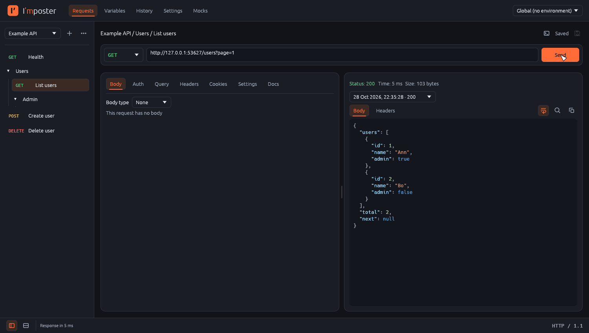
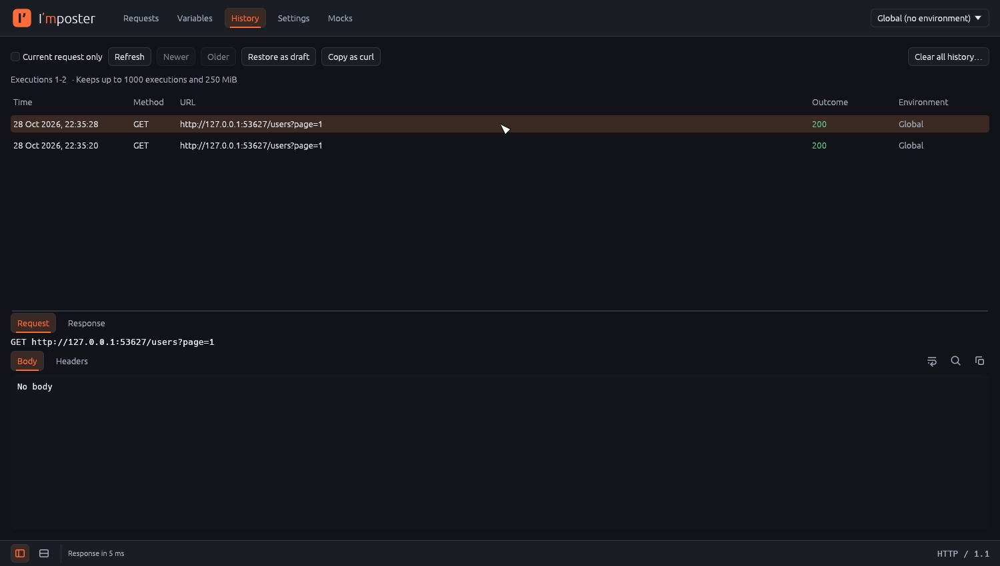

# Poster

A fast, local desktop HTTP API client. Build requests, organize them in collections, reuse
values through variables and environments, and keep a searchable history of everything you
sent. It runs as one native binary per OS, with no account, no cloud and no telemetry.



Poster is written in Rust with [egui](https://github.com/emilk/egui). It replaces an earlier
Python/PyQt6 version, and reads and writes the same `.poster.json` collection format.

## Features

**Requests**
- Collections with nested folders. Move requests and folders by dragging, or with Move.
- Any method, custom methods included; query parameters kept in sync with the URL.
- Headers, cookies, and bodies as JSON, plain text, URL-encoded form, multipart (text fields
  and file uploads) or a binary file. Uploads are streamed from disk.
- Authentication: Basic, Bearer and Digest (MD5, SHA-256, SHA-512, `-sess`).
- Per-request settings that override the application defaults: timeout, redirects,
  certificate verification, cookies, proxy, CA bundle, client certificate and key, and
  response size limit.
- Autosave, or explicit save. Unsaved changes are never lost silently: switching requests,
  restoring from history and closing all ask first.

**Variables**
- `{{name}}` placeholders in the URL, headers, body, auth and settings.
- Three scopes: global, per collection, and environments. The active environment overrides
  the collection, which overrides globals.
- Placeholders are highlighted: defined names in orange, unknown ones in red. Typing `{{`
  suggests names. Clicking a placeholder, or pressing Alt+Enter, shows where its value comes
  from. Values from password fields stay masked until revealed.

**Responses**
- Status, time, size and content type at a glance.
- JSON, XML and HTML highlighting, formatted JSON, find, wrap and copy. Large bodies stay
  responsive (the viewer only lays out what is visible; previews stop at 256 KiB).
- Earlier runs of the same request stay one click away.

**History**
- Every execution with its environment, the request exactly as it was sent, and the full
  response.
- Restore an execution as an unsaved draft, or copy it as a curl command.
- Retention by number of entries and total size.



**Import and export**
- Native `.poster.json` (version 1), compatible with the Python version.
- Postman Collection v2.1 import and export, validated against the official schema, with
  environment and globals files. Anything Postman features Poster cannot represent is listed
  before import; changes to how a request runs need explicit consent.
- Imports never overwrite: names that already exist get a suffix, existing globals win.
- curl: paste a command (including the "Copy as cURL" output of Chrome and Firefox, for bash
  or cmd) to open it as a draft, or copy any request as a ready-to-run curl command.

**Interface**
- Side-by-side or stacked request and response, switched from the status bar. Collections
  sidebar can be hidden. Splitter positions, window size and the last selection are restored.
- Dark theme. Every control has an accessible name for screen readers; text colors meet
  WCAG AA contrast.

## Not supported

Pre-request and test scripts; WebSocket, gRPC and GraphQL-specific tools; HTTP/2 (requests
use HTTP/1.1); cloud sync and sharing; a persistent cookie jar (cookies are sent as you list
them); themes other than the dark one.

## Installation

### Packages

Release packages are built by CI from version tags: a `.dmg` for macOS (Apple Silicon), a
`.deb` and an `.AppImage` for Linux (x86_64), and an installer for Windows (x86_64). Until
the first release is published, build from source.

The packages are not signed with an Apple or Microsoft developer certificate yet, so the first
launch needs one extra step:
- **macOS 15 and later:** open Poster once and dismiss the warning, then go to System Settings
  → Privacy & Security and click **Open Anyway** next to the Poster message.
- **macOS 14 and earlier:** right-click Poster in Applications, choose Open, then Open again.
- **Windows:** in the SmartScreen prompt, click More info → Run anyway.

### From source

You need [rustup](https://rustup.rs). The pinned toolchain (`rust-toolchain.toml`) is
installed automatically on the first build. No system libraries or C compiler are needed
beyond what Rust itself requires.

```sh
git clone https://github.com/vargg/poster.git
cd poster
cargo run --release -p poster
```

The binary is `target/release/poster`.

On Linux, the app loads the usual desktop libraries at runtime: OpenGL/EGL, X11 or Wayland,
and xkbcommon. File dialogs go through the XDG desktop portal
(`xdg-desktop-portal` with a backend for your desktop).

## Usage

1. Create a collection with **+ → New Collection**, then add requests with **+ → New
   Request** (or Cmd/Ctrl+N).
2. Enter a URL, choose a method, add what the request needs in the tabs below, and **Send**.
3. Put shared values on the **Variables** screen (globals, an environment, or the
   collection) and use them as `{{name}}`. Choose the active environment at the top right.
4. Find any earlier execution on the **History** screen.
5. Application defaults (timeout, proxy, TLS, history limits, autosave) are on **Settings**.

### Keyboard shortcuts

Cmd on macOS, Ctrl elsewhere. Shortcuts do nothing while a dialog is open.

| Shortcut | Action |
|---|---|
| Cmd/Ctrl+Enter, Cmd/Ctrl+R | Send (or cancel the running request) |
| Cmd/Ctrl+S | Save the current screen: request, variables or settings |
| Cmd/Ctrl+N | New request (a new collection when there is none) |
| Cmd/Ctrl+F | Find in the viewer under the pointer |
| Alt+Enter | Inspect the variable at the cursor |
| Esc | Close the inspector, find bar or suggestions |

### Moving from the Python version

Export each collection from the Python app as `.poster.json` (with its environments and
globals if you want them), then use **+ → Import Collection…** in Poster. The two apps never
share a database, so the Python app keeps working.

## Your data

Everything lives in one SQLite database: `~/.poster/poster.db`. Set `POSTER_DATA_DIR` to use
another directory (for a second profile, or for testing):

```sh
POSTER_DATA_DIR=/tmp/poster-scratch poster
```

Before a new version changes the database format, the old database is copied to
`poster.db.bak-<version>` next to it. A database written by a newer version is refused
rather than changed.

Logs go to stderr; `POSTER_LOG` sets the level (for example `POSTER_LOG=debug`). Poster never
logs credentials, tokens, or request and response bodies.

## Development

```sh
scripts/check.sh            # everything CI checks: format, clippy, tests, coverage floors
cargo test -p poster-http   # one crate
cargo run -p poster         # debug build
```

`scripts/check.sh` needs `cargo-llvm-cov` and LLVM's coverage tools:
`cargo install cargo-llvm-cov` and `rustup component add llvm-tools`. CI runs the same checks
on macOS, Linux and Windows.

The workspace is split by responsibility; each layer only depends on the ones before it,
which an architecture test enforces:

| Crate | Responsibility |
|---|---|
| `poster-core` | Domain types and rules: variables, settings, URLs, request preparation, curl. No IO. |
| `poster-http` | HTTP transport: TLS (rustls), redirects, Digest auth, streamed uploads, cancellation. |
| `poster-store` | SQLite persistence on its own thread, with migrations and backups. |
| `poster-transfer` | `.poster.json` and Postman v2.1 conversion and validation. |
| `poster-app` | Services the UI calls: execution, saving, history, import and export. |
| `poster-ui` | The egui interface. |
| `poster` | The binary. |
| `poster-testkit` | Loopback servers and certificates for tests. |

Further reading:
- [AGENTS.md](AGENTS.md): architecture principles, rules and decisions, with their reasons.
  Read it before changing anything substantial.
- [docs/testing.md](docs/testing.md): where tests go and how they are written.
- [docs/validation.md](docs/validation.md): the manual checklist run before each release.
- [docs/release.md](docs/release.md): packaging, signing and cutting a release.

`cargo run -p poster-ui --example screenshot -- <dir>` renders the app with sample data to
PNG files, without a display.

Request tabs open on **Body**, followed by Auth, Query, Headers, Cookies, Settings and Docs.
Use Docs to edit the request description; it saves and exports with the request.
