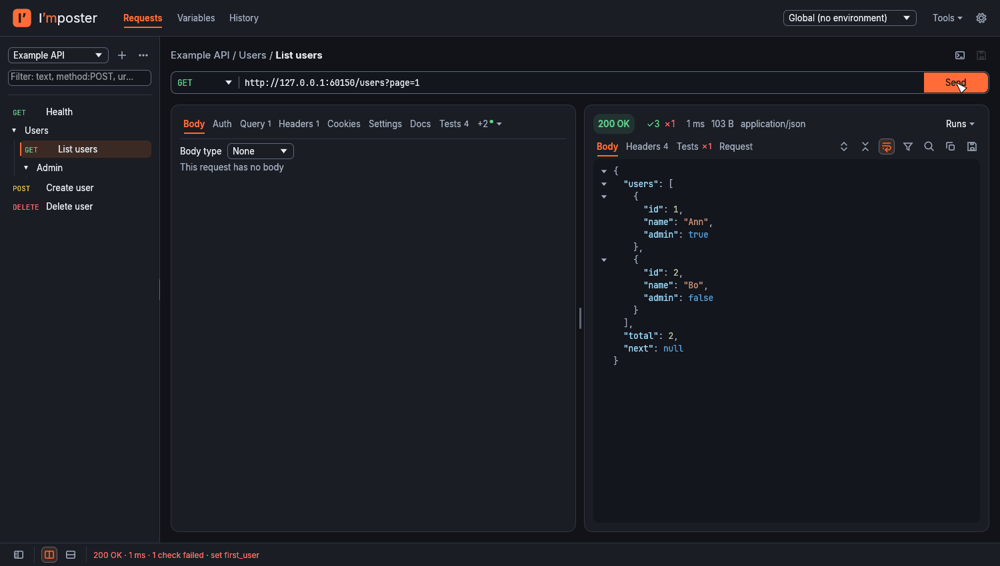
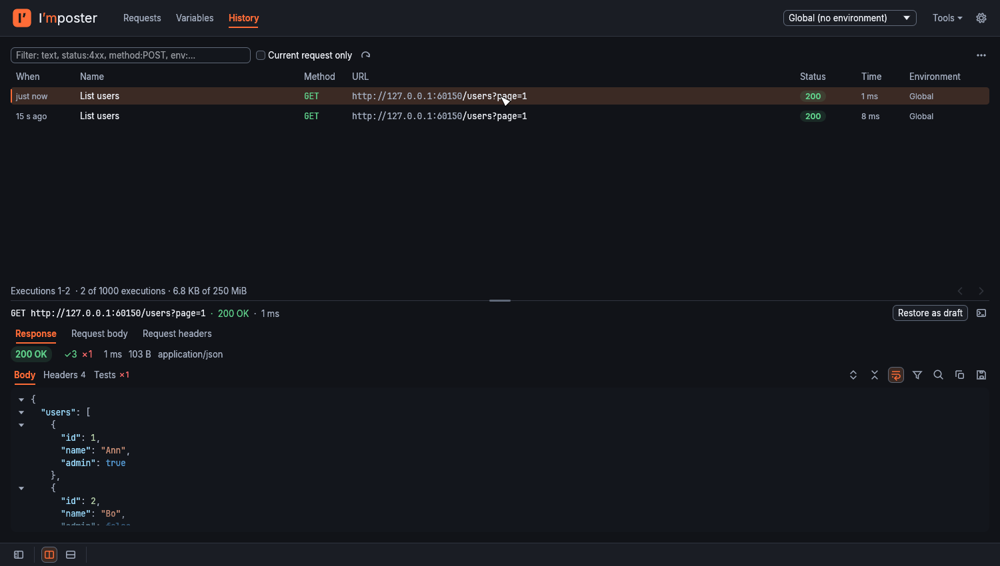

# I’mposter

A fast, local desktop HTTP API client. Build requests, organize them in collections, reuse
values through variables and environments, and keep a searchable history of everything you
sent. It runs as one native binary per OS, with no account, no cloud and no telemetry.



I’mposter is written in Rust with [egui](https://github.com/emilk/egui). It replaces an earlier
Python/PyQt6 version and imports its native collection format. New exports use `.imposter.json`
(native version 3 when scripts are present, otherwise version 2); existing `.poster.json`
files still import.

On one M3 Pro Mac, the packaged 0.6.0 smoke workflow measured **218.6 ms median
launch-to-request** and **106.1 MiB median peak resident memory** across ten runs after
a warm-up. These are warm-cache, fresh-profile measurements, not first-frame or idle-memory
figures. See the [machine, method and all samples](docs/validation.md#packaged-060-measurements).

## Features

**Requests**
- Collections with nested folders. Drag requests and folders to reorder them or move them into a folder, or use Move up, Move down (Alt+↑/↓) and Move….
- Any method, custom methods included; query parameters kept in sync with the URL.
- Headers, cookies, and bodies as JSON, plain text, URL-encoded form, multipart (text fields
  and file uploads) or a binary file. Uploads are streamed from disk.
- Authentication: Basic, Bearer and Digest (MD5, SHA-256, SHA-512, `-sess`).
- Per-request settings that override the application defaults: timeout, redirects,
  certificate verification, cookies, proxy, CA bundle, client certificate and key, and
  response size limit.
- Autosave, or explicit save. Unsaved changes are never lost silently: switching requests,
  restoring from history and closing all ask first.

**Variables**
- `{{name}}` placeholders in the URL, headers, body, auth and settings.
- Three scopes: global, per collection, and environments. The active environment overrides
  the collection, which overrides globals.
- Give an environment a color (a new one named "prod", "production" or "live" is offered
  red). Its name appears in the header's environment picker, tinted in its color, and Send
  names a colored environment (for example, **Send to Prod**) before anything goes out.
- Placeholders are highlighted: defined names in orange, unknown ones in red. Typing `{{`
  suggests names. Clicking a placeholder, or pressing Alt+Enter, shows where its value comes
  from. Values from password fields stay masked until revealed.
- Generated values, made fresh for each send: `{{$uuid}}`, `{{$timestamp}}`,
  `{{$timestampMs}}`, `{{$isoTimestamp}}`, `{{$date %Y-%m-%d}}` (each takes an offset such as
  `-1d` or `+2h`), `{{$randomInt 1 100}}` and `{{$randomString 12}}`. One expression is one
  value throughout a send, so the same `{{$uuid}}` in the URL and the body match; add a word
  for another value (`{{$uuid second}}`). Postman's `$guid`, `$randomUUID`, `$timestamp`,
  `$isoTimestamp` and `$randomInt` work as imported. Type `{{$` for the list.
- Saved values: keep several values of one variable (user IDs, names) in its scope, then swap
  the current one from the placeholder's inspector in one click. Each environment keeps its
  own list. Native exports carry saved values with their variables; Postman exports carry the
  current value only.

**Responses**
- Status, time, size and content type at a glance.
- JSON, XML and HTML highlighting, formatted JSON, find, wrap and copy. Large bodies stay
  responsive (the viewer only lays out what is visible; previews stop at 256 KiB).
- Fold formatted JSON by object or array, or collapse everything below the top level.
  Hover a line and open its **⋯** menu, or right-click, to copy its JSONPath
  (`$.data.items[3].id`) or its value.
- Filter a JSON response with JSONPath (RFC 9535), for example `$.items[?@.active == true].id`.
  The filter reads the whole captured body, not just the preview, and stays set when you send
  again. Copying the path of a result gives its path in the full body.
- Earlier runs of the same request stay one click away.

**Checks**
- Each request can carry checks, edited in its Tests tab and run after every response: the
  status (`= 200`, `= 2xx`), a header, a JSONPath into the body, the body text, the duration
  or the size, compared with `=`, `≠`, `<`, `≤`, `>`, `≥`, contains, matches (a regular
  expression), exists or is of type. Expected values can use `{{variables}}`.
- Results appear beside the response status (for example, `✓3 ✗1`) and in its Tests tab,
  with what was read for each check, and stay with the run in History. A check that cannot
  be decided says **Not checked** with the reason.
- Right-click a JSON value and choose Add check to check for it. OpenAPI import adds a status
  check for each operation's documented success.
- Set variables from a response, for example a login's `token` from `$.access_token` or a
  created item's id: the value goes to the scope that defines the variable, or to the active
  environment, and the next request uses it. Right-click a JSON value and choose Set variable
  to add one. Nothing is set while the Variables screen has unsaved changes to that scope.

**Scripts**
- Each request can have two [Rhai](https://rhai.rs) scripts, edited in its Scripts tab. The
  before-sending script runs with variables and generated values filled in and can change
  the method, URL, query, headers and a JSON or text body; what it changes is what is sent,
  and what History and Copy as curl show. Use it to sign a request (HMAC), add computed
  headers or stamp a body.
- The after-response script reads the response (status, headers, body, JSON, JSONPath) and
  runs tests, shown with the checks and kept in History. Both scripts can set variables,
  which go where captures go.
- Scripts never touch files, the network or the environment. Each may run 2 seconds and a
  million operations; Cancel stops one. A failing before-sending script stops the send and
  says which line failed. What scripts print shows under the response and is not kept.
- A collection or folder can have the same two scripts, run around every request inside it:
  shared signing, an API key header, common tests. Open them from the collection's "⋯" menu
  (**Collection Scripts…**) or a folder's right-click menu (**Scripts…**). Before sending,
  the collection's run first, then each folder's from the outermost, then the request's;
  after the response, in the same order. A request's Scripts tab lists what else runs.
- "Insert example…" adds a ready-made script; "Script reference" lists everything below.

| When | Use | What it does |
|---|---|---|
| Before sending | `request.method, request.url` | Read or change the method and URL. Setting the URL takes its query from it. |
| Before sending | `request.header(name), request.set_header(name, value), request.add_header(name, value), request.remove_header(name)` | Read or change headers; names ignore case. set_header replaces every value of the name. Auth headers are added after the script. |
| Before sending | `request.query(name), request.set_query(name, value), request.remove_query(name)` | Read or change query parameters; the URL follows. |
| Before sending | `request.body, request.json()` | The body as text, or parsed as JSON. A JSON or text body can be replaced; form, multipart and file bodies cannot. |
| After response | `request` | The request as it was sent: the same fields, read-only. |
| After response | `response.status, response.reason, response.time_ms, response.size, response.truncated` | The status, its reason, the time in milliseconds, the body's size in bytes, and whether the body was cut at the capture limit. |
| After response | `response.header(name), response.headers` | One header (every value joined with ", "), or all of them by lowercase name. |
| After response | `response.body, response.json(), response.path(jsonpath)` | The body as text, parsed as JSON, or the value a JSONPath selects (several values as an array, none as ()). |
| After response | `test(name, condition), test(name, \|\| { … })` | A test, shown with the checks and kept in History. A closure fails when it returns false or throws. |
| Request scripts | `vars.get(name), vars.set(name, value)` | Read a variable, or set one for later requests: it goes where captures go (the scope that defines it, else the active environment, else Global). |
| Mock responses | `request.method, request.path, request.query(name), request.header(name), request.headers` | The request the route matched, read-only; headers by name, ignoring case. |
| Mock responses | `request.body, request.json()` | The request's body as text (up to 1 MiB), or parsed as JSON. |
| Mock responses | `response.status, response.body, response.set_header(name, value), response.remove_header(name)` | The answer, starting from the route's status, headers and body. Statuses are 200 to 599; the server sets Content-Length itself. |
| Mock responses | `response.send_json(value)` | Answer with a value as JSON, setting Content-Type. |
| Mock responses | `response.delay_ms` | Wait before answering, up to 10,000 ms. |
| Mock responses | `state` | A map kept between requests while the server runs; it starts empty on every Start. |
| Every script | `expect(actual, expected)` | Throws "expected …, got …" when they differ: inside a test it fails the test with that message. |
| Every script | `sha256(data), sha512(data), sha1(data), md5(data)` | Digests of text or bytes, as bytes. |
| Every script | `hmac_sha256(key, data), hmac_sha512(key, data), hmac_sha1(key, data)` | HMACs of text or bytes, as bytes; a key may be the bytes of an earlier HMAC. |
| Every script | `hex(data), base64_encode(data), base64url_encode(data), base64_decode(text)` | Encode text or bytes; base64_decode gives bytes (`.as_string()` reads them as text). |
| Every script | `url_encode(text), url_decode(text)` | Percent-encoding as RFC 3986: everything but letters, digits and - _ . ~ is escaped. |
| Every script | `uuid(), now_ms(), now_iso(), random_int(min, max)` | Generated values, as {{$uuid}}, {{$timestampMs}}, {{$isoTimestamp}} and {{$randomInt}} make them. |
| Every script | `parse_json(text), to_json(value)` | JSON text to a value and back. |
| Every script | `print(value), debug(value)` | Write to the console: under the response (not kept in History), or in the Mocks screen's request log. |

**Load tests**
- Send one request many times from the Load screen (Tools → Load, a request's right-click menu,
  or the command palette), as `ab` does: total requests, concurrency, an optional time
  limit and ramp-up, with or without keep-alive. Every request gets fresh generated values.
- The summary: requests and bytes per second, the share of errors (failed checks count),
  min, mean and percentiles of the whole exchange and of the time to the first byte, a
  "served within" table, counts by status and error, and a latency histogram. The last ten
  runs of the session stay a menu away.
- The request's scripts run for every request, so signed APIs can be load-tested; the
  after-response script's tests count with the checks. Script time is not counted as
  response time, and the first script error is shown on the result.
- Runs stay out of History and never set variables, from captures or scripts. With a red
  environment active, Start asks first.
- This is a **closed-loop, single-request probe**: each worker waits for its response before
  sending again. A slow server therefore receives fewer requests, which can understate tail
  latency compared with independent arrivals. These results do not establish production
  capacity; use a specialist load-testing tool for that work.

**History**
- Every execution with its environment, the request exactly as it was sent, and the
  captured response, subject to the configured capture and history limits.
- Search it with the sidebar's filter language plus `status:404`, `status:4xx`,
  `status:failed` and `env:Dev`; words match the request name and URL (bodies are not
  searched).
- Restore an execution as an unsaved draft, or copy it as a curl command.
- Retention by number of entries and total size.



**Import and export**
- Native `.imposter.json` (`"format": "imposter"`) carries request checks, captures, saved
  variable values and environment colors. Exports use **version 3** when a request, folder
  or collection has scripts, and **version 2** otherwise. Script-free exports remain
  readable by Imposter 0.4.
  `.poster.json` files from the Python version (version 1) import unchanged; the Python
  version cannot read Imposter versions 2 or 3.
- Postman Collection v2.1 import and export, validated against the official schema, with
  environment and globals files. Anything Postman features Imposter cannot represent is listed
  before import; changes to how a request runs need explicit consent. Postman JavaScript
  scripts are removed only with consent; Postman exports report Rhai scripts they cannot
  preserve.
- OpenAPI 3.0, 3.1 and 3.2 import (JSON or YAML): one request per operation, grouped by tag,
  with the server URL in a `baseUrl` collection variable, path parameters as variables,
  example bodies from the document's examples or schemas, and its security schemes as auth
  with empty secret variables to fill in. Each import creates a new collection.
- Imports never overwrite: names that already exist get a suffix, existing globals win.
- curl: paste a command (including the "Copy as cURL" output of Chrome and Firefox, for bash
  or cmd) to open it as a draft, or paste it over the whole URL field (Cmd/Ctrl+L, then
  paste) to replace the open request; copy any request as a ready-to-run curl command.

**Interface**
- Requests, Variables and History stay in the header. Tools opens Mocks and Load; the
  gear opens application Settings. Running tools stay visible in the status bar: click
  their status to return to the screen. Unsaved mock edits mark Tools, even with its menu
  closed; unsaved application settings mark the gear.
- Command palette (Cmd/Ctrl+K) over actions, the requests of every collection and
  environments; recent requests with Cmd/Ctrl+P, and Ctrl+Tab back to the previous one.
- Sidebar filter: text, `"phrases"`, `method:POST`, `url:users`, `name:…`, `-word`, OR.
- Side-by-side or stacked request and response, switched from the status bar. Collections
  sidebar can be hidden. Splitter positions, window size and the last selection are restored.
- Dark, light or system theme, and Compact or Comfortable density (Settings → Appearance).
  Every control has an accessible name for screen readers; text colors meet WCAG AA
  contrast in both themes, and control edges 3:1.

## Not supported

Postman JavaScript (`pm.*`) compatibility; WebSocket, gRPC and GraphQL-specific tools;
HTTP/2 (requests use HTTP/1.1); cloud sync; a persistent cookie jar (cookies are sent as you
list them). Before-sending and after-response scripts are supported in Rhai. Collections
can be shared through native exports; repository project folders and a runner for whole
folders are planned, not shipped.

## Installation

### Packages

Release packages are built by CI from version tags: a `.dmg` for macOS (Apple Silicon), a
`.deb` and an `.AppImage` for Linux (x86_64), and an installer for Windows (x86_64).
Download published packages from [GitHub Releases](https://github.com/vargg/imposter/releases),
or build from source below. The release workflow creates a draft first; its packages become
public when the release is published.

For packages without an Apple or Microsoft developer certificate, the first launch needs
one extra step (macOS bundles still carry an ad-hoc signature):
- **macOS 15 and later:** open Imposter once and dismiss the warning, then go to System Settings
  → Privacy & Security and click **Open Anyway** next to the Imposter message.
- **macOS 14 and earlier:** right-click Imposter in Applications, choose Open, then Open again.
- **Windows:** in the SmartScreen prompt, click More info → Run anyway.

### From source

You need [rustup](https://rustup.rs). The pinned toolchain (`rust-toolchain.toml`) is
installed automatically on the first build. No system libraries or C compiler are needed
beyond what Rust itself requires.

```sh
git clone https://github.com/vargg/imposter.git
cd imposter
cargo run --release -p imposter
```

The binary is `target/release/imposter`.

On Linux, the app loads the usual desktop libraries at runtime: OpenGL/EGL, X11 or Wayland,
and xkbcommon. File dialogs go through the XDG desktop portal
(`xdg-desktop-portal` with a backend for your desktop).

## Usage

1. Create a collection with **+ → New Collection**, then add requests with **+ → New
   Request** (or Cmd/Ctrl+N).
2. Enter a URL, choose a method, add what the request needs in the tabs below, and **Send**.
3. Put shared values on the **Variables** screen (globals, an environment, or the
   collection) and use them as `{{name}}`. Choose the active environment at the top right.
4. Find any earlier execution on the **History** screen.
5. Application defaults (timeout, proxy, TLS, history limits, autosave) are behind the
   **Settings** gear in the header.

### Keyboard shortcuts

Cmd on macOS, Ctrl elsewhere. Shortcuts do nothing while a dialog is open.

| Shortcut | Action |
|---|---|
| Cmd/Ctrl+K | Command palette: actions, requests and environments |
| Cmd/Ctrl+P | Find a request, recent ones first |
| Ctrl+Tab | Back to the previous request; hold Ctrl and press Tab to go further |
| Ctrl+Shift+Tab | Step through recent requests from the oldest |
| Cmd/Ctrl+Enter, Cmd/Ctrl+R | Send (or cancel the running request) |
| Cmd/Ctrl+S | Save the current screen: request, variables or settings |
| Cmd/Ctrl+N | New request (a new collection when there is none) |
| Cmd/Ctrl+D | Duplicate the open request |
| F2, Ctrl+Shift+R | Rename the open request |
| Alt+↑ | Move the selected request or folder up among its siblings |
| Alt+↓ | Move the selected request or folder down among its siblings |
| Cmd/Ctrl+L | Select the request URL |
| Cmd/Ctrl+Shift+F | Format the JSON body |
| Cmd/Ctrl+B | Show or hide the collections sidebar |
| Cmd/Ctrl+, | Open Settings |
| Cmd/Ctrl+Shift+/ | Show keyboard shortcuts |
| Cmd/Ctrl+F | Find in the viewer under the pointer |
| Alt+Enter | Inspect the variable at the cursor |
| Esc | Close the inspector, find bar or suggestions |

### Command line

`imposter send` runs one of your saved requests without a window, through the same engine
as **Send**. Edit requests in the app, then run them from a terminal, a script or a coding
agent; there is nothing to export.

```sh
export API_TOKEN=…
imposter send "Shop API / Users / Create user" --env Dev --secret token=API_TOKEN
```

The request is named by its breadcrumb, collection first, as the app shows it above the
request bar (spaces around `/` are optional; write a `/` inside a name as `\/`). A wrong path
lists every saved request. Only the environment named with `--env` applies, never the one
the app has active, and an environment marked red (production) is refused unless you turn
on Settings → Command line → **Allow production environments** in the app. The run is kept
in History, marked **CLI** (find them with `via:cli`); values its captures and scripts set
stay in the run and change none of your variables. It works while the app is open.

The result is one JSON document on stdout, led by a `summary` and an `outcome`, with the
request as sent, the response head, check and script results, captures and body excerpts.
A one-line summary goes to stderr.

For CI, or a machine without your data, export the collection (**⋯ → Export Collection…**,
with the environments it needs) and add `--file api.imposter.json`. A file run uses the
application defaults, writes no History and reads nothing else; the result records the
file's SHA-256.

| Option | Meaning |
|---|---|
| `--file FILE` | Read a collection file (.imposter.json) instead of your I’mposter data, as CI does. Nothing is written to History. |
| `--env NAME` | Use environment NAME; without it, only globals and collection variables apply, whatever the app has active. |
| `--input VAR=PROCESS_VAR` | Set variable VAR from the process variable PROCESS_VAR, above every scope. Repeatable. |
| `--secret VAR=PROCESS_VAR` | As --input, and remove its value from the result and error output. Repeatable. |
| `--out FILE` | Also write the result to FILE; History opens it (⋯ → Open result file…). |
| `--max-body BYTES` | Show at most BYTES of each body in the result (default 65536; 0 shows none). |

Every outcome has its own exit status, so CI can tell a failed check from a server that was
not there. A response with no checks is not a pass: nothing was verified.

| Status | Outcome | Meaning |
|---|---|---|
| 0 | `passed` | a response arrived and every check and script test passed |
| 1 | `failed` | a check or script test failed |
| 2 | `usage` | the command line was wrong, or the result file could not be written |
| 3 | `not_sent` | nothing was sent: the file, request path, environment, an input or the request is wrong |
| 4 | `transport_error` | no response: connection, TLS or timeout |
| 5 | `script_failed` | a script failed or was stopped |
| 6 | `not_checked` | a check could not be decided (cut body, bad path), none failed |
| 7 | `no_checks` | a response arrived but the request has no checks: nothing verified |
| 130 | `cancelled` | interrupted (Ctrl+C) |

Secrets given with `--secret`, and the credentials the request sends (Basic and Digest
passwords, Bearer tokens, the client key password), are replaced by `«redacted»` everywhere
in the result and on stderr, as are `user:password@` in URLs and the values of
`Authorization`, `Cookie` and `Set-Cookie` headers. This removes known values only: a server
can return other sensitive data, which a result shows like any body. Copy as curl in the app
still includes credentials, as it always did.

For a coding agent, `imposter skill` prints instructions on running requests, passing
secrets and reading results. Put them wherever your agent reads instructions; I’mposter
writes no agent configuration itself.

`imposter mcp` is an experiment: an MCP server over stdio that lets a chat tool list your
saved requests (or those of a `--file`) and send one, with the environment and inputs you
give on its command line. Its tools and output may change or go away.

### Moving from the Python version

Export each collection from the Python app as `.poster.json` (with its environments and
globals if you want them), then use **+ → Import Collection…** in Imposter. The two apps never
share a database, so the Python app keeps working.

## Your data

I’mposter is the display name; the installed app is **Imposter**, the command is `imposter`,
and the compact header wordmark is **I’mp**.

On default-profile startup, if the new database is absent, the app copies the previous Rust
Poster profile at `~/.poster/poster.db` using SQLite's backup API, including committed WAL data.
Collections, variables, settings, history, mocks and UI state are preserved. The old database
is left logically unchanged. An existing new database always wins; profiles are never merged.
A busy, unreadable, corrupt or newer-schema legacy profile produces an error with recovery
instructions instead of silently starting empty. Close Poster and retry a busy copy.

Everything lives in one SQLite database: `~/.imposter/imposter.db`. Set `IMPOSTER_DATA_DIR` to use
another directory (for a second profile, or for testing):

```sh
IMPOSTER_DATA_DIR=/tmp/imposter-scratch imposter
```

Before a new version changes the database format, the old database is copied to
`imposter.db.bak-<version>` next to it. A database written by a newer version is refused
rather than changed.

An explicit `IMPOSTER_DATA_DIR` uses `imposter.db` in that directory and never looks for or
copies the personal legacy profile. An empty override is an error. Update existing scripts:
`POSTER_DATA_DIR` and `POSTER_LOG` are no longer recognized; use `IMPOSTER_DATA_DIR` and
`IMPOSTER_LOG`.

Logs go to stderr; `IMPOSTER_LOG` sets the level (for example `IMPOSTER_LOG=debug`). Imposter never
logs credentials, tokens, or request and response bodies.

## Credits

The interface is set in [Inter](https://rsms.me/inter/) and data in
[JetBrains Mono](https://www.jetbrains.com/lp/mono/), both under the SIL Open Font License 1.1;
the licenses ship in `crates/imposter-ui/assets/fonts` and inside every package.

## Development

The root Makefile wraps the existing Cargo commands and scripts. It requires GNU Make
and a POSIX shell (on Windows, use Git Bash with GNU Make). `make` lists all targets.

```sh
make run                                  # debug application
make release                              # optimized binary
make test                                 # all workspace tests
make test CRATE=imposter-http TEST=redirect  # one crate, optional test-name filter
make fmt                                  # format Rust code
make lint                                 # Clippy, warnings are errors
make check                                # full verification gate, including coverage
make screenshots OUT=/tmp/imposter-shots     # render the UI offscreen
make smoke                                # build and smoke-test the debug application
make package                              # local packages for the host OS
make clean                                # remove build artifacts, keep application data
```

`make check` and `make coverage` both run `scripts/check.sh`, including the Python smoke-tool
tests; coverage thresholds and exclusions remain defined there. Install its prerequisites with
`cargo install cargo-llvm-cov` and `rustup component add llvm-tools`. CI also checks macOS,
Linux and Windows. Cargo and rustup must be on `PATH`; the repository pins the toolchain.

Use `TEST_ARGS="--nocapture"` to pass arguments to the test harness, and `PYTHON=python`
if that is your Python 3 executable. `make smoke BINARY="path/to/imposter"` tests an existing
executable without rebuilding; smoke tests open a real window and need a display (Xvfb
on headless Linux). Their database is temporary.

`make package` requires `cargo-packager` 0.11.8; install it with
`cargo install cargo-packager --locked --version 0.11.8`. It defaults to `app,dmg` on macOS,
`deb,appimage` on Linux, and `nsis` on Windows; override with, for example,
`make package FORMATS=app`. It uses the existing packaging configuration and
`target/packages/` output, with `CI=true` to skip interactive DMG styling. Packaging uses
the repository's default Cargo target directory. See [release.md](docs/release.md) for
signing and release instructions; the Makefile does not tag, push, or publish releases.

The workspace is split by responsibility; each layer only depends on the ones before it,
which an architecture test enforces:

| Crate | Responsibility |
|---|---|
| `imposter-core` | Domain types and rules: variables, settings, URLs, request preparation, curl, checks. No IO. |
| `imposter-http` | HTTP transport: TLS (rustls), redirects, Digest auth, streamed uploads, cancellation. |
| `imposter-store` | SQLite persistence on its own thread, with migrations and backups. |
| `imposter-transfer` | Native (`.imposter.json`, `.poster.json`), Postman v2.1 and OpenAPI 3 conversion and validation. |
| `imposter-app` | Services the UI calls: execution, saving, history, import and export. |
| `imposter-ui` | The egui interface. |
| `imposter` | The binary. |
| `imposter-testkit` | Loopback servers and certificates for tests. |

Further reading:
- [AGENTS.md](AGENTS.md): architecture principles, rules and decisions, with their reasons.
  Read it before changing anything substantial.
- [docs/testing.md](docs/testing.md): where tests go and how they are written.
- [docs/validation.md](docs/validation.md): the manual checklist run before each release.
- [docs/release.md](docs/release.md): packaging, signing and cutting a release.

`cargo run -p imposter-ui --example screenshot -- <dir>` renders the app with sample data to
PNG files, without a display.

Request tabs open on **Body**, followed by Auth, Query, Headers, Cookies, Settings, Docs,
Tests, Captures and Scripts. Tabs that do not fit are in **More**. Use Docs to edit the
request description; it saves and exports with the request.

Right-click a request and choose **Duplicate** to create and open a saved sibling copy.
An open request copies its current edits; navigation still resolves unsaved changes.

Settings → **Host client certificates** assigns a client certificate, optional key and password to an exact HTTPS host and port (default 443). Request overrides take priority. Redirects select credentials again for their destination. Copy as curl uses the initial identity and cannot reproduce identity switching across redirects.

Use **Tools → Mocks** to configure a local HTTP server on `127.0.0.1` (port 8080 by default; 0 chooses an available port). Add routes by exact method and encoded path, with a response status, headers and text body. Query strings and request bodies do not affect matching; unmatched requests return 404. Save before Start; edits to a running server apply after Stop and Start. Configuration persists, but the server never starts automatically and stops when Imposter closes.

A mock answers locally from the routes and scripts you define. A passing check against
that answer does **not verify the live API**.

A route can also have a response script (Rhai, as request scripts are) that starts from its status, headers and body and changes them from the request: echo it, answer 400 when a field is missing, fail the first call and succeed after, or wait before answering. `state` keeps values between requests until the server stops:

```rhai
state.calls = (state.calls ?? 0) + 1;
if state.calls == 1 { response.status = 503; }
response.send_json(#{ calls: state.calls, item: request.json().item });
```

Scripts read request bodies up to 1 MiB, run one at a time for at most a second, and a failing one answers 500 with its line. A route whose script does not compile keeps the server from starting. While it runs, "Answered requests" lists what came in and what went out, with script errors and printed lines (never bodies).
